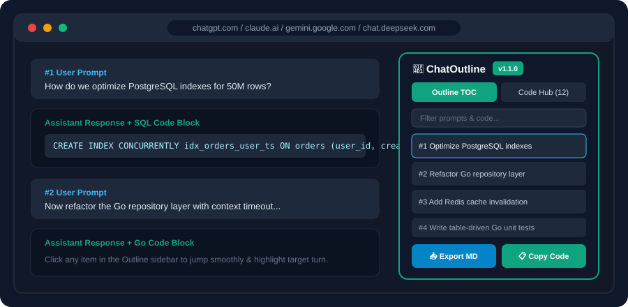

# ChatOutline Pro 📑

**Universal Floating Table of Contents, 1-Click Markdown Exporter & Code Hub for ChatGPT, Claude, Google Gemini & DeepSeek.**  
Never scroll endlessly through 50+ message AI chats or lose track of buried code blocks again. Export clean conversations straight to **Obsidian** or **Notion** with 100% local, zero-telemetry execution.

[-24292F?style=for-the-badge&logo=github)](https://github.com/SamLu574/chatoutline-pro/releases/tag/v1.1.0)

  

---

## ⚡ Why Install ChatOutline?

When coding or researching with **ChatGPT, Claude, DeepSeek, or Gemini**:
- Conversations quickly hit **40 to 100+ turns** with thousands of lines of generated code.
- Finding a prompt from 30 minutes ago means furiously flicking the mouse wheel while heavy chat DOM lags.
- Copying multi-turn discussions into **Obsidian, Notion, or Logseq** breaks Markdown fences and takes tedious manual cleanup.

**ChatOutline fixes all of this in under 15ms — 100% locally inside your browser.**

---

## 🚀 1-Minute Installation

### Option 1: One-Click Install (Microsoft Edge)
👉 **[Install directly from Microsoft Edge Add-ons Store (v1.1.0 Free)](https://microsoftedge.microsoft.com/addons/detail/mmnmfeljpmjdpmpbelhnebldimmoaokb)**

### Option 2: Chrome / Brave / Arc / Vivaldi (Load Unpacked ZIP)
1. Download [`chatoutline-pro-v1.1.0.zip`](https://github.com/SamLu574/chatoutline-pro/releases/tag/v1.1.0) and unzip it.
2. Open `chrome://extensions/` (or `brave://extensions/`) and toggle **Developer mode** ON.
3. Click **Load unpacked** and select the extracted folder.
4. Open [ChatGPT](https://chatgpt.com), [Claude](https://claude.ai), [Gemini](https://gemini.google.com), or [DeepSeek](https://chat.deepseek.com) to see the floating **`📑 Outline`** pill!

---

## ✨ Key Features & Tiers

| Feature | Free (Open Core) | Pro ($3.00 Lifetime) |
| :--- | :---: | :---: |
| Floating Conversation Table of Contents (TOC) | ✅ Unlimited Free | ✅ Unlimited Lifetime |
| Instant Smooth Teleportation & Highlight | ✅ Unlimited Free | ✅ Unlimited Lifetime |
| Real-time Fuzzy Filter Across Prompts | ✅ Unlimited Free | ✅ Unlimited Lifetime |
| Supported Sites (ChatGPT, Claude, Gemini, DeepSeek) | ✅ All 4 Platforms | ✅ All 4 Platforms |
| Code Hub Code Block Extraction | 2 Preview Blocks | **✅ Unlimited All Code Blocks** |
| **1-Click Batch Copy All Code Blocks** | ❌ | **✅ Included** |
| **1-Click Export Full Chat to Markdown (Obsidian/Notion)** | ❌ | **✅ Included** |
| **Lifetime Updates (One-Time Payment)** | ❌ | **✅ Included** |

👉 **[Unlock Lifetime Pro License ($3.00 USD on Gumroad)](https://lusam.gumroad.com/l/chatoutline)** *(No subscription — pay once, use forever)*

---

## 🔒 Privacy & Architecture

- **100% Client-Side Execution**: No external servers, no telemetry, no analytics scripts, and zero prompt data leaving your browser.
- **Anti-Breakage DOM Observers**: Uses semantic attributes (`data-message-author-role`, semantic containers, debounced `MutationObserver`) instead of brittle Tailwind class hashes.
- **Minimal Permissions**: Only requests `storage` to save your local UI state and Pro license status.

---

## 🌐 Links

- **Landing Page & Docs**: [https://samlu574.github.io/chatoutline-pro/](https://samlu574.github.io/chatoutline-pro/)
- **Microsoft Edge Add-ons**: [Edge Store Listing](https://microsoftedge.microsoft.com/addons/detail/mmnmfeljpmjdpmpbelhnebldimmoaokb)
- **Lifetime Pro License**: [Gumroad Checkout ($3.00)](https://lusam.gumroad.com/l/chatoutline)
- **License**: [MIT License](LICENSE) © 2026 Guoqiang Lu
